<div align="center">

# Ascend

**A local-first trading journal: log every trade, see your patterns, and ask an AI coach about them.**


<picture>
  <source media="(prefers-color-scheme: dark)" srcset="docs/readme/dashboard-dark.png">
  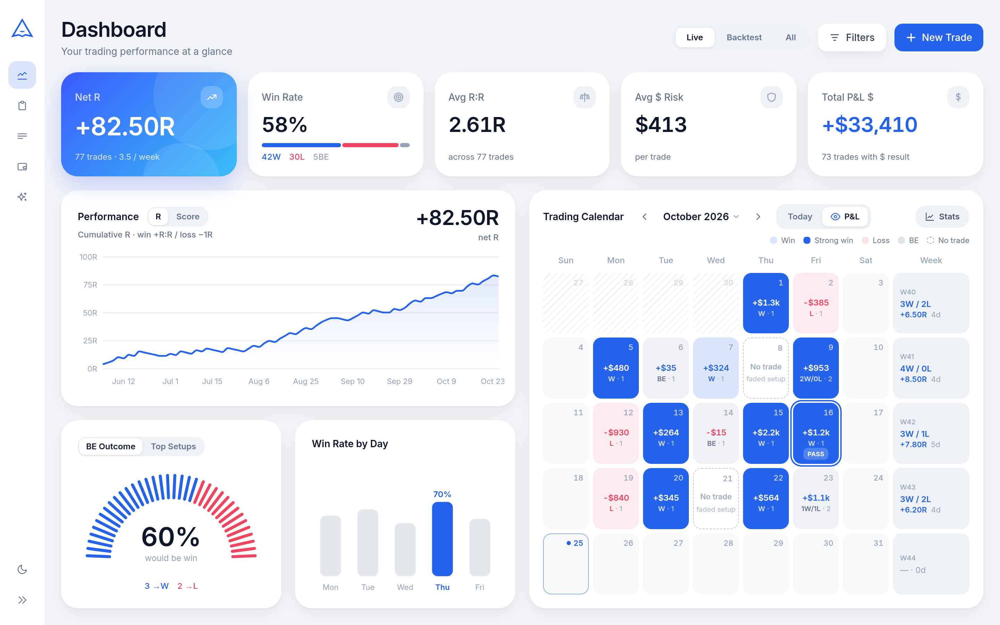
</picture>

<sub>All screenshots use generated demo data (98 trades, fictional prop firms, synthetic charts).</sub>

</div>

---

## Why Ascend?

Spreadsheets don't keep your chart screenshots, and journaling SaaS wants an account plus a monthly fee. Ascend runs on your own machine, with **no accounts, no cloud backend and no telemetry**. Trades, notes and screenshots stay in a local SQLite database and an uploads folder. One ZIP backs up everything.

It's built around how discretionary futures traders review their trading: results in **R**, setups ("entry models") as tags, notes on psychology and premarket analysis for every trade, and **no-trade days** count as journal entries too.

---

## Features

### Journaling

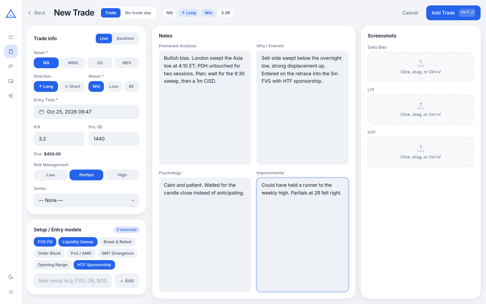

- **One-screen trade form.** Live / Backtest, asset (NQ, MNQ, ES, MES), direction, result (Win / Loss / Breakeven) and risk management (Low / Perfect / High) are button rows. Live summary chips sit in the header, and **Ctrl/Cmd + Enter** saves.
- **R:R + P&L $ → risk**: enter the R:R and the dollar result, and Ascend works out the dollar risk for you.
- **Breakeven outcome.** Tag a breakeven trade with what it *would* have become (BE → Win / BE → Loss).
- **Entry models (setups)** are a multiselect. Create them inline in the form and drag to reorder them.
- **Four note fields**: Premarket Analysis, Why I Entered, Psychology and Improvements.
- **Screenshots**: Daily Bias, LTF and HTF zones. Paste with Ctrl+V while hovering a zone, drag & drop, or click to upload.
- **No-trade days**: a header toggle switches the form to a day entry with *Why I didn't trade*, *Faded setups*, premarket and psychology notes. No-trade days appear on the calendar but don't touch your stats.
- **Strategy Lab**: build strategies as checklists of entry models. A rule can be one model or "any of" a group (e.g. IFVG / CISD). Pick a strategy on a trade and it can only be saved once every rule is ticked; the last used strategy is preselected. Filter and compare strategies on the dashboard.
- **Series**: group trades into named runs (e.g. an eval attempt or a backtest study) and filter by them.

### Dashboard

<table>
  <tr>
    <td width="50%">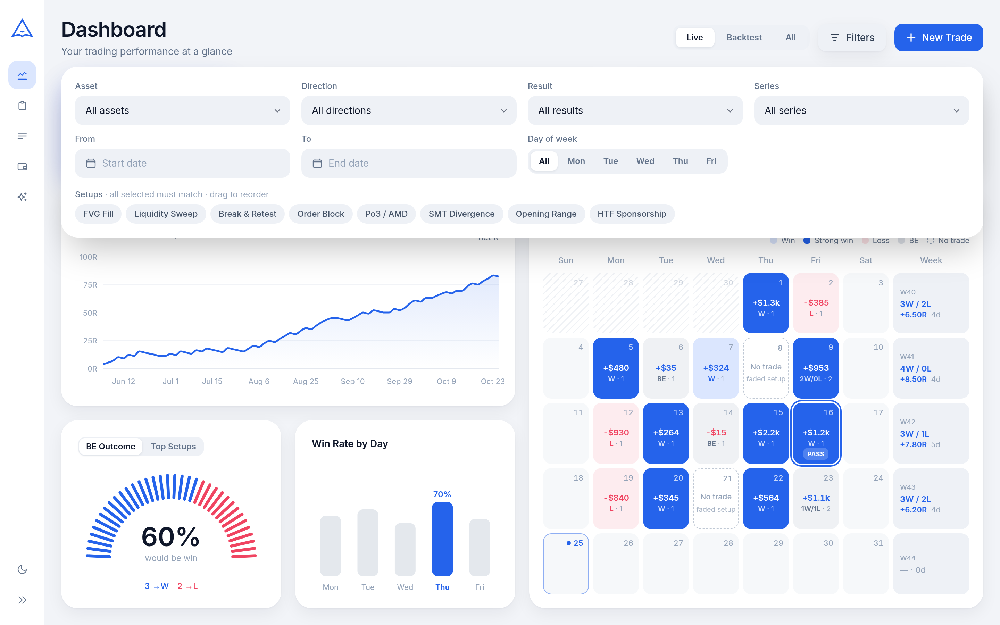</td>
    <td width="50%">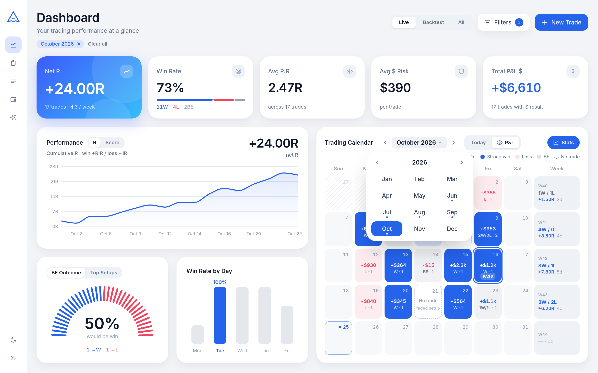</td>
  </tr>
  <tr>
    <td><sub>Floating filters: asset, direction, result, series, dates, day of week, setups (AND)</sub></td>
    <td><sub>Calendar <b>Stats</b>: the whole dashboard follows the month on screen, plus the month picker</sub></td>
  </tr>
</table>

- **Live / Backtest / All** switch plus a floating filter panel. Filters live in the URL, so a filtered view can be bookmarked and Back returns to it.
- **Stat cards**: Net R, Win Rate (with a W / L / BE bar), Avg R:R, Avg $ Risk and Total P&L $.
- **Performance curve**: cumulative **R** (win = +R:R, loss = −1R) or a simple **Score** (+1 / −1).
- **BE Outcome gauge**: how many of your breakevens would have turned into winners. Shares a card with **Top Setups**, which ranks entry models by win rate, and **Strategies** (win rate, Net R and trade count per strategy).
- **Win Rate by Day**, Monday to Friday, with the best day highlighted.
- **Heatmap trading calendar** with win / strong win / loss / BE tiles, weekly summaries, an optional $ P&L view, dashed *No trade* tiles and a month picker. A **PASS** ring marks the day a prop account was passed. Click a day to open its trade.

### Trades list & detail

<table>
  <tr>
    <td width="50%">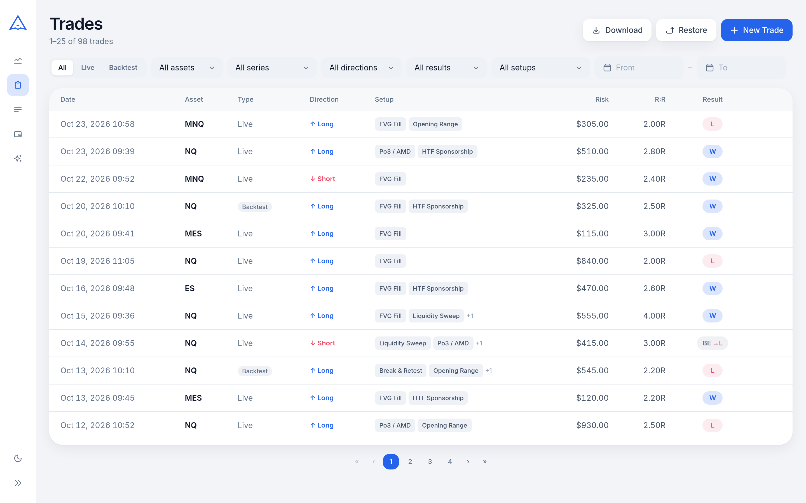</td>
    <td width="50%">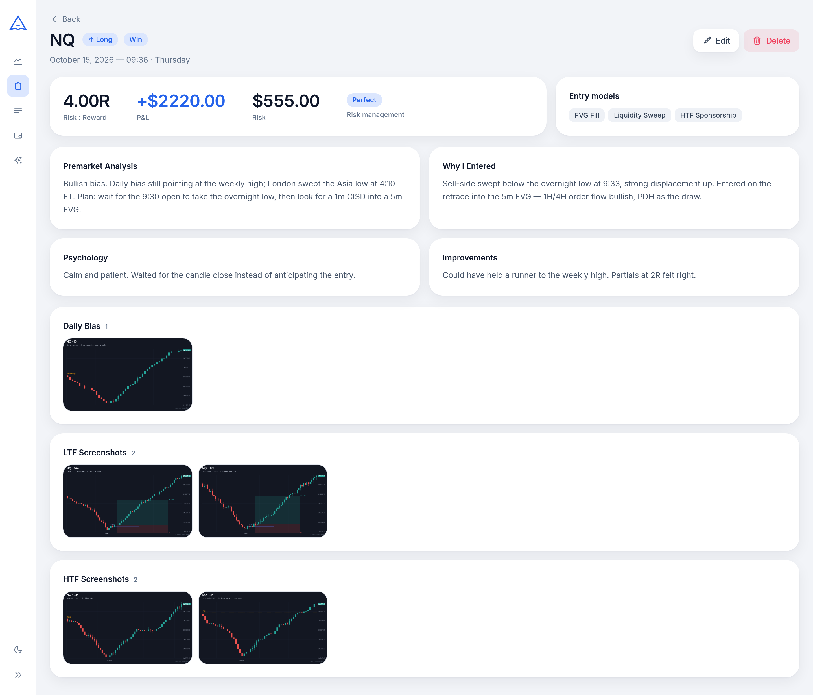</td>
  </tr>
  <tr>
    <td><sub>Filterable, paginated table (25 per page)</sub></td>
    <td><sub>Read-only detail with notes and a screenshot lightbox</sub></td>
  </tr>
</table>

### Prop firm expenses & payouts

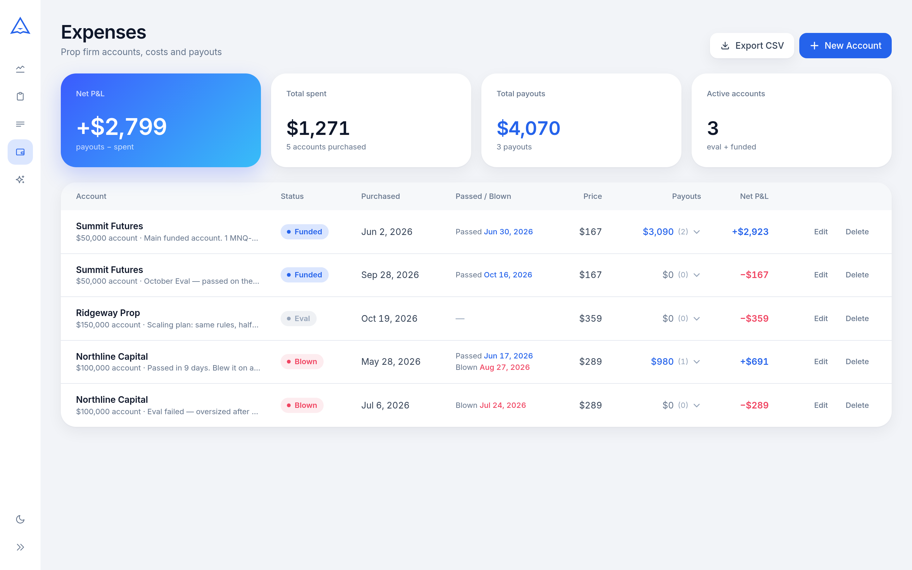

Track every evaluation and funded account: firm, size, price, status (**eval → funded → blown**), passed / blown dates, notes and payouts. The summary shows total spent, total payouts, net P&L and active accounts, and the accounts export to CSV.

### AI Analyst

Pick a slice of your journal and ask questions about it in plain language.

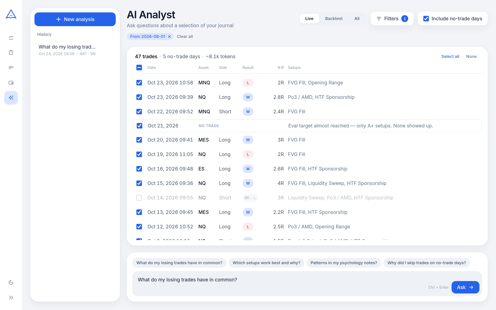

<table>
  <tr>
    <td width="50%">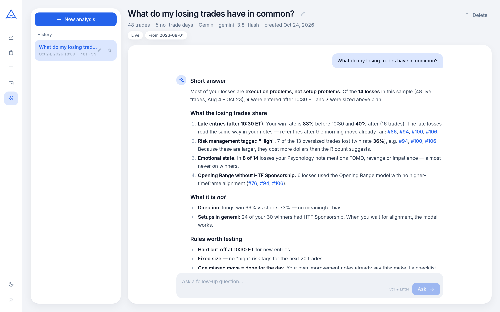</td>
    <td width="50%">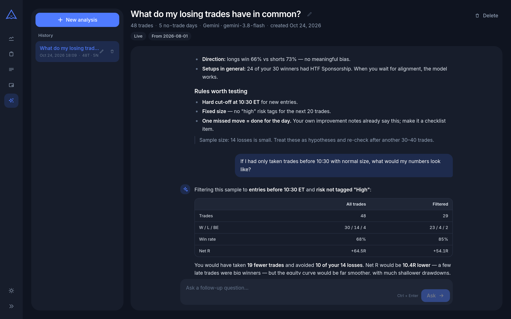</td>
  </tr>
  <tr>
    <td><sub>Markdown answer, with every cited trade a clickable <code>#id</code> link</sub></td>
    <td><sub>Follow-ups in the same conversation (dark theme)</sub></td>
  </tr>
</table>

- **Filter → select → ask.** Use the same filters as the dashboard, untick individual trades, and choose whether to include no-trade days. A live **token estimate** shows how big the request will be.
- **Frozen snapshot.** The selected trades and notes are serialized once when the conversation starts, so follow-ups always discuss the same data even after you edit your journal.
- **Streamed answers** over Server-Sent Events, rendered as markdown (tables included). Every trade the model cites as `#123` becomes a link to that trade.
- **Grounded prompt.** The model must cite trade ids, flag small samples and never invent numbers. It answers in the language of your question.
- **History.** Conversations are saved locally and can be renamed, deleted and continued later. Each one remembers its provider and model.
- **Gemini or Claude**, chosen by which API key you set. The keys stay on the server and the browser never sees them.
- **Text only.** Screenshots are never sent to the provider.

### Backup, restore & themes

- **Backup & restore**: on the Trades page, *Download* saves the database and all screenshots as one ZIP. *Restore* swaps it back in after a confirmation, with no restart needed.
- **Light & dark theme**, toggled in the sidebar and remembered per browser. The sidebar collapses to an icon rail that slides out on hover and can be pinned.

---

## Getting started

### Docker (recommended for daily use)

```bash
git clone https://github.com/MatejSulic/TradeJournalCla.git
cd TradeJournalCla
docker compose up -d --build
```

Open **http://localhost:7420**. A single container serves both the built client and the API. It's set to `restart: unless-stopped`, so it comes back after a reboot. `server/data` (database) and `server/uploads` (screenshots) are bind-mounted from the repo, so your data lives outside the container. After pulling new code, run `docker compose up -d --build` again.

### Development mode

Requires **Node.js 20.12+** (the Docker image uses Node 22) and npm.

```bash
npm run install:all   # root + server + client dependencies
npm run dev           # API on http://localhost:3001, client on http://localhost:5173
```

Open http://localhost:5173. Vite proxies `/api` and `/uploads` to the server. The SQLite database is created at `server/data/journal.db` on first run, and migrations run automatically on startup.

> Docker and dev mode share the same database. Stop one (`docker compose stop`) before starting the other.

### One-click launchers

`Spustit.sh` (Linux/macOS) and `Spustit.bat` (Windows) check for Node.js, install dependencies on first run, start the app and open your browser.

### AI Analyst setup (optional)

```bash
cp .env.example .env
```

| Variable | Purpose |
|---|---|
| `GEMINI_API_KEY` | Gemini key (the free tier works) |
| `ANTHROPIC_API_KEY` | Claude key (optional) |
| `GEMINI_MODEL` / `ANTHROPIC_MODEL` | Model overrides (defaults: `gemini-3.8-flash`, `claude-sonnet-5-5`) |
| `AI_PROVIDER` | Force `gemini` or `anthropic` (only used if that key is set) |

If both keys are set, **Claude is the default** unless `AI_PROVIDER` says otherwise. Keep each line as bare `KEY=value` with comments on their own lines: docker compose treats an inline `# …` after an empty value as the value itself. Then restart the server (`docker compose up -d --build` for Docker). Without a key, the AI page shows a "not configured" notice and the rest of the app works normally.

---

## Privacy

- Everything runs locally: the database, the screenshots and the AI conversation history.
- No accounts and no analytics. The only outside requests are the Inter web font (Google Fonts) and, **when you ask the AI Analyst a question**, the **text** of the trades and no-trade days you selected (fields and notes, never screenshots) goes to the provider you configured.
- The API only accepts same-origin requests, so other websites can't trigger writes or spend your AI quota. Docker binds the port to `127.0.0.1` only.

---

## Tech stack

| Layer | Technology |
|---|---|
| Frontend | React 18, Vite 5, React Router 6 |
| Styling | Tailwind CSS 3 with CSS-variable theme tokens (light + dark) |
| Charts | Recharts (area, bar), plus custom SVG/CSS gauge and calendar |
| Markdown | react-markdown + remark-gfm (AI answers) |
| Backend | Node.js, Express 4 |
| Database | SQLite via better-sqlite3 (WAL mode, foreign keys on) |
| Uploads / backup | Multer (20 MB per screenshot), adm-zip |
| AI | `@google/genai`, `@anthropic-ai/sdk`, streamed to the client over SSE |
| Runtime | Docker (single container) or `concurrently` in dev |

### Architecture

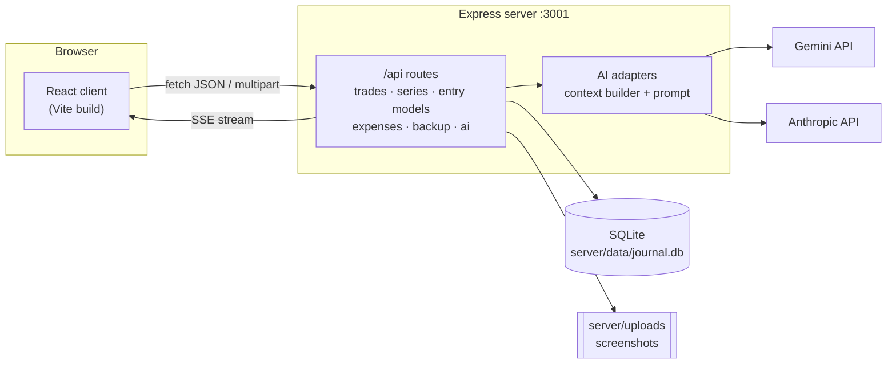

The client is a single-page app. All dashboard stats are computed in the browser from the filtered trade list. The server is a thin REST layer over SQLite and also serves the built client and the screenshots. Schema changes are idempotent migrations that run at startup, so old databases and restored backups upgrade automatically.

<details>
<summary><b>Project structure</b></summary>

```
TradeJournalCla/
├── docker-compose.yml / Dockerfile   # single-container build (client + API) on :7420
├── Spustit.sh / Spustit.bat          # one-click launchers
├── .env.example                      # AI provider keys / model overrides
├── client/src/
│   ├── App.jsx                       # routes
│   ├── api.js                        # all /api calls
│   ├── pages/                        # Dashboard, TradeForm, TradeDetail, TradeList,
│   │                                 # Series, Expenses, AiAnalyst
│   ├── components/
│   │   ├── dashboard/                # StatCards, PerformanceCurve, TopSetups, BeOutcome, WinRateByDay
│   │   ├── ai/                       # ConversationList, SelectionList, ChatMessages, Composer, Markdown
│   │   ├── TradeCalendar.jsx         # heatmap calendar + month picker
│   │   ├── TradeFilters.jsx, Layout.jsx, ConfirmDialog.jsx, DatePicker.jsx, Logo.jsx
│   ├── contexts/ThemeContext.jsx     # light / dark
│   └── hooks/useThemeColors.js       # theme-aware chart colors
├── server/
│   ├── index.js                      # Express entry, same-origin guard, static client + uploads
│   ├── db.js                         # schema, migrations, reinitDb() after restore
│   ├── routes/                       # trades, entryModels, series, expenses, backup, ai
│   ├── ai/                           # gemini, anthropic, mock adapters; context.js; prompt.js
│   ├── test/                         # node:test unit tests
│   ├── data/                         # SQLite DB (bind-mounted in Docker)
│   └── uploads/                      # screenshots (gitignored)
├── scripts/dev/                      # api-smoke.sh, screenshots.mjs, demo-data.mjs
└── docs/readme/                      # README screenshots
```

</details>

<details>
<summary><b>Data model</b></summary>

```sql
trades              (id, day_type, asset, session_type, series_id, direction, pnl, be_outcome,
                     risk_reward, risk_amount, pnl_dollars, entry_time,
                     premarket_analysis, why_entered, no_trade_reason, faded_setups,
                     psychology, improvements, risk_management, created_at, updated_at)
entry_models        (id, name UNIQUE, sort_order)
trade_entry_models  (trade_id, entry_model_id)          -- many-to-many
screenshots         (id, trade_id, type, filename, original_name, created_at)
series              (id, name UNIQUE, description, created_at, updated_at)
prop_accounts       (id, firm_name, account_size, purchase_price, status,
                     purchased_at, passed_at, blown_at, notes, created_at, updated_at)
prop_payouts        (id, account_id, amount, payout_date, notes, created_at)
ai_conversations    (id, title, provider, model, filters, context,
                     trade_count, notrade_count, created_at, updated_at)
ai_messages         (id, conversation_id, role, content, created_at)
```

- `day_type` is `trade` or `notrade`. Trade fields are required only for trades.
- `pnl` is the **result** (`win` / `loss` / `breakeven`). Money lives in the optional `pnl_dollars`.
- `screenshots.type` is `daily_bias`, `ltf` or `htf`. `prop_accounts.status` is `eval`, `funded` or `blown`.
- `ai_conversations.context` holds the frozen text snapshot the conversation is about.

</details>

### Tests & dev scripts

| Command | What it does |
|---|---|
| `cd server && npm test` | Unit tests (`node --test`): AI context builder, provider selection, paths, same-origin guard |
| `scripts/dev/api-smoke.sh [db]` | Boots a scratch copy of the server on a **copy** of a DB (port 3999) and checks trade / no-trade CRUD |
| `node scripts/dev/screenshots.mjs <outDir> [baseUrl]` | Playwright screenshots of every page in light/dark at two viewports. Blocks writes and fails on console errors, `NaN` or unwanted page scroll |
| `node scripts/dev/demo-data.mjs <baseUrl> <scratchDb>` | Fills a **scratch** server with deterministic demo data (the data in these screenshots). Refuses to run against the real DB |

---

## What I learned

- **SQLite is genuinely good for local apps.** `better-sqlite3`'s synchronous API keeps the server code simple, and WAL mode handles concurrent reads with no extra setup.
- **Recharts needs a real height.** `height="100%"` renders nothing unless every ancestor has a resolved height. It's the first thing I check when a chart disappears.
- **Client-side filtering on top of server data is a valid pattern.** The day-of-week filter and all dashboard stats run in the browser after a single fetch.
- **LLM features need guard rails more than prompts.** Freezing the context per conversation, keeping keys server-side, blocking cross-origin writes and making the model cite `#id`s mattered more than prompt wording.
- **CSS `grid-template-rows: 0fr / 1fr` is an underrated collapsible trick.** No JavaScript height maths, and it adapts to content automatically.

---

## Author

**Matěj Šulič**

[GitHub](https://github.com/MatejSulic) · [LinkedIn](https://linkedin.com/in/matej-sulic) · sul.matej@gmail.com

## License

A personal use and learning project. There is no license file, so do what you want with it.

---

<sub>Partly vibe coded with <a href="https://claude.ai">Anthropic Claude</a>.</sub>
